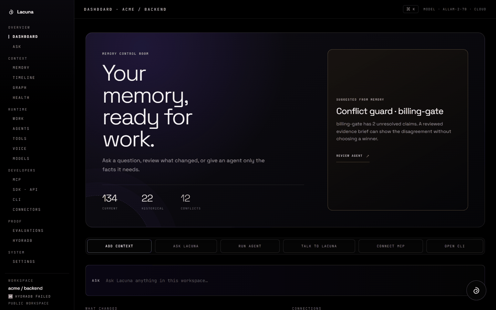
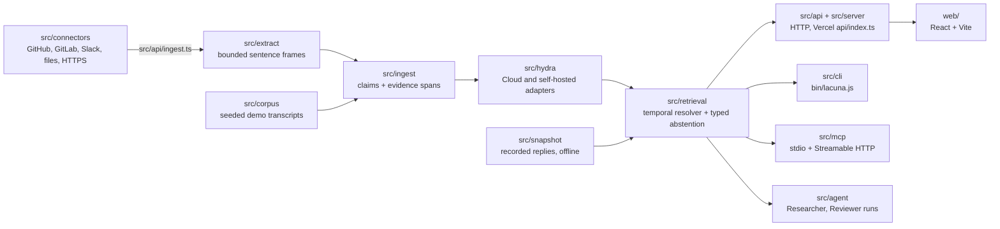

<p align="center">
  
</p>

<h1 align="center">Lacuna</h1>

<p align="center"><strong>Memory that knows what changed, what remains true, and what was never known.</strong></p>

<p align="center">
  <a href="https://github.com/vaibhav4046/lacuna/actions/workflows/ci.yml"></a>
  <a href="LICENSE"></a>
</p>

<p align="center">
  <a href="https://lacuna-five.vercel.app/explore"><strong>Live workspace</strong></a>
  · <a href="#quickstart">Quickstart</a>
  · <a href="docs/EVIDENCE_INDEX.md">Evidence</a>
  · <a href="docs/MCP.md">MCP</a>
  · <a href="CONTRIBUTING.md">Contribute</a>
</p>

Lacuna is a temporal, provenance-first memory layer for AI agents: every claim
stays tied to the sentence it came from, corrections supersede instead of
overwrite, conflicts stay visible, and the resolver abstains with a typed reason
when the evidence cannot support an answer.



<sub>The public read-only workspace at
<a href="https://lacuna-five.vercel.app/explore">lacuna-five.vercel.app/explore</a>,
captured 2026-11-21 at 1440x900. The page loads, but its HydraDB Cloud backend
currently answers <code>402 FREE_PLAN_DEPRECATED</code> (see the
<code>HYDRADB FAILED</code> badge), so live questions return
<code>SYSTEM_ERROR</code>. The offline snapshot server in the
<a href="#quickstart">Quickstart</a> needs no service.</sub>

### What this demonstrates

- **A typed answer-or-abstain contract for agent memory.** The resolver in
  [`src/retrieval/`](src/retrieval) walks `SUPERSEDES` and conflict relations
  and returns either an answer with its evidence span or one of five abstention
  reasons (`never_stated`, `retracted`, `contradicted`, `unconnected`,
  `out_of_scope`, defined in [`src/model/abstention.ts`](src/model/abstention.ts)).
- **One read contract behind four surfaces.** The same retrieval code serves the
  HTTP API ([`src/api/`](src/api)), a CLI ([`src/cli/`](src/cli)), a React web
  app ([`web/`](web)) and an MCP server over stdio and Streamable HTTP
  ([`src/mcp/`](src/mcp)).
- **A retrieval eval harness with real baselines.** [`src/bench/`](src/bench)
  scores Lacuna against BM25, local-embedding vector, hybrid, 2-hop and recency
  retrievers on the same generated corpus and gold questions, counting
  unsupported answers separately from accuracy (see [Results](#results)).

It was built for **Hack Hydra 2026, Track 03: Memory and Context Retrieval**,
on [HydraDB](https://github.com/hydra-db/hydradb).

## Try the failure cases first

These four questions cover the outcomes that matter. Ask them in the
[live workspace](https://lacuna-five.vercel.app/explore) once its backend is
back, or locally with `npm run serve:snapshot`:

| Ask | What Lacuna should show |
| --- | --- |
| `what does token-forge depend on?` | A current answer with exact evidence |
| `who is the runbook owner for billing-gate?` | Two conflicting sources and a refusal to choose silently |
| `when does Lowbank launch?` | A statement that was later withdrawn |
| `what is the connection pool size for Foxglove?` | That nobody ever stated it |

## Why another memory layer?

Most agent memory stacks reduce history to nearby text chunks. That is useful
for recall, but similarity does not answer the questions that determine whether
a memory is safe to use:

- Is this claim still current?
- Was it replaced by a later statement?
- Do two sources disagree?
- Which exact sentence supports the answer?
- Was the fact never stated at all?

Lacuna stores an immutable evidence graph. Corrections create `SUPERSEDES`
relationships instead of deleting the old claim. Retrieval applies bounded
temporal and relationship policy, returns the proof path, and emits a typed
abstention when the graph cannot justify an answer.

## What ships

| Surface | Current role |
| --- | --- |
| **Web** | Ask, memory table, interactive graph, provenance paths, timelines and public judge flows |
| **CLI** | Nine commands over the same read contract; see [CLI.md](docs/CLI.md) |
| **MCP** | Seven verified public read-only tools over Streamable HTTP and local stdio; see [MCP.md](docs/MCP.md) |
| **HydraDB Cloud** | Production persistence, deterministic record reads, query and relation inspection |
| **Self-hosted HydraDB** | Native nodes, edges and bounded Cypher traversal |
| **Agents and Work** | Governed Researcher and Reviewer runs with bounded Context Packs and inspectable lifecycle evidence |

The fastest verified path is the
[public workspace](https://lacuna-five.vercel.app/explore). The precise release
boundary and all current caveats live in
[V10_RELEASE_STATUS.md](docs/V10_RELEASE_STATUS.md).

## Quickstart

### Reproduce the resolver without a database

This path uses the checked-in HydraDB response snapshot. It is the quickest way
to inspect the product and run the tests without a token or external service.
Node.js 20.11 or newer; no API key is needed for any step in this block.

```bash
git clone https://github.com/vaibhav4046/lacuna.git
cd lacuna
npm ci
npm --prefix web ci   # the root typecheck and some unit tests import web/src
npm run typecheck
npm test              # unit tests; tests/contract needs a live HydraDB node
npm run serve:snapshot
```

These are the same commands CI runs ([`.github/workflows/ci.yml`](.github/workflows/ci.yml)),
plus `npm run build` for the web bundle.

Open <http://127.0.0.1:3015>.

### Run the full self-hosted stack

Requirements:

- Node.js 20.11 or newer
- a HydraDB node built from the upstream revision pinned in
  [SOURCE_LOG.md](docs/SOURCE_LOG.md)

```bash
cp .env.example .env.local
scripts/hydra-node.sh start
npm run ingest
npm run census
npm run serve
```

Open <http://127.0.0.1:3014>. Keep `.env.local` untracked and never commit a
HydraDB token. Full ingestion mechanics are documented in
[INGEST.md](docs/INGEST.md).

## MCP

The public production endpoint is:

```text
https://lacuna-five.vercel.app/mcp
```

A local client can spawn the stdio server:

```json
{
  "mcpServers": {
    "lacuna": {
      "command": "npm",
      "args": ["run", "mcp", "--", "--stdio"],
      "cwd": "/absolute/path/to/lacuna"
    }
  }
}
```

Exact ChatGPT, Claude, Claude Code, Cursor, Grok Bot, REST and CLI instructions are in
[CONNECT_CLIENTS.md](docs/CONNECT_CLIENTS.md). Named-client instructions are not
claims that every client has completed an external verification run; the
release-status document records what has actually been proven.

## Architecture



The production Cloud adapter and the self-hosted graph adapter do real but
different work. The Cloud answer path fetches deterministic records and applies
Lacuna's temporal policy in application code. The self-hosted adapter executes
bounded Cypher over native nodes and edges. They are deliberately documented as
separate evidence boundaries.

Read the complete architecture in
[ARCHITECTURE_FINAL.md](docs/ARCHITECTURE_FINAL.md) and its invariants in
[ARCHITECTURE_INVARIANTS.md](docs/ARCHITECTURE_INVARIANTS.md).

## Results

Lacuna against flat retrieval baselines on the generated demo corpus (seed
`lacuna-demo-v1`, 5,246 messages, 64 gold questions, 51 configurations). Best
configuration of each approach, copied from the committed raw output in
[artifacts/bench/report.txt](artifacts/bench/report.txt):

| system | correct | false answers | abstention F1 | mean context tokens |
| --- | --- | --- | --- | --- |
| lacuna | 64/64 | 0 | 1.000 | 18 |
| hybrid+2hop@50 +conflict | 63/64 | 0 | 1.000 | 1843 |
| lexical@20 +conflict | 48/64 | 0 | 0.889 | 516 |
| hybrid@20 +conflict | 48/64 | 0 | 0.889 | 529 |
| vector@50 +conflict | 47/64 | 0 | 0.889 | 1311 |
| recency@50 +conflict | 46/64 | 0 | 0.877 | 1029 |

Reproduce with `npm run bench` against a local HydraDB node loaded by
`npm run ingest` (see [Run the full self-hosted stack](#run-the-full-self-hosted-stack)).
Caveats: the corpus and questions are generated by this repository and written
in the sentence frames the extractor reads, so this measures the resolver's
temporal and abstention policy, not open-domain extraction. Latency is left out
because it depends on the machine; it is in the raw report. Details are in
[docs/BENCHMARKS.md](docs/BENCHMARKS.md).

## Evidence, not benchmark theatre

Start with these documents:

- [Evidence index](docs/EVIDENCE_INDEX.md): dated proof artifacts and commands
- [V10 release status](docs/V10_RELEASE_STATUS.md): what the current production build proves and what remains open
- [LongMemEval boundary](docs/BENCHMARK_LONGMEMEVAL.md): official dataset adapter scope without inventing an official score
- [Benchmarks](docs/BENCHMARKS.md): measured repository checks and their limitations
- [Reproduction record](artifacts/repro/README.md): fresh-clone execution evidence

The generated 64-question evaluation is a deterministic repository correctness
check. It is **not** an official LongMemEval score. Lacuna currently has no
official LongMemEval answer/judge score.

## Honest limits

- As of 2026-11-21 the hosted deployment's HydraDB Cloud account returns `402 FREE_PLAN_DEPRECATED`, so live web and REST answers return `SYSTEM_ERROR` and MCP `lacuna_ask` returns a graph read error until the backend plan is restored. The snapshot server and the self-hosted stack are unaffected.
- The production extractor reads a bounded set of sentence frames, not arbitrary English.
- A sentence outside those frames produces no claim rather than a guess.
- The public preview is read-only; authenticated workspace writes have separate auth and CSRF boundaries.
- The Cloud and self-hosted HydraDB adapters must not be described as the same execution path.
- The exact current test status, including the worker-thread parser isolation flake observed on some serial runs, is recorded in [V10_RELEASE_STATUS.md](docs/V10_RELEASE_STATUS.md).

## Contributing

Useful contributions are welcome, especially:

- high-precision extraction fixtures that preserve abstention;
- reproducible failure cases and regression tests;
- clearer installation, MCP and connector documentation;
- accessibility and responsive-product fixes;
- benchmark adapters that keep ground truth isolated.

Read [CONTRIBUTING.md](CONTRIBUTING.md), choose an item from the
[public roadmap](docs/ROADMAP.md), or open a scoped issue. Claims in code,
documentation and launch material must point to reproducible evidence.

## Security

Do not publish credentials, private workspace data or working exploits in an
issue. Follow [SECURITY.md](SECURITY.md) for private reporting and supported
versions.

## License

Apache-2.0. See [LICENSE](LICENSE) and [NOTICE](NOTICE).

Built by [Vaibhav Lalwani](https://github.com/vaibhav4046).

If Lacuna solves a real problem for you, starring the repository helps other
agent builders find it. A failure case, issue or contribution is even more
useful.
